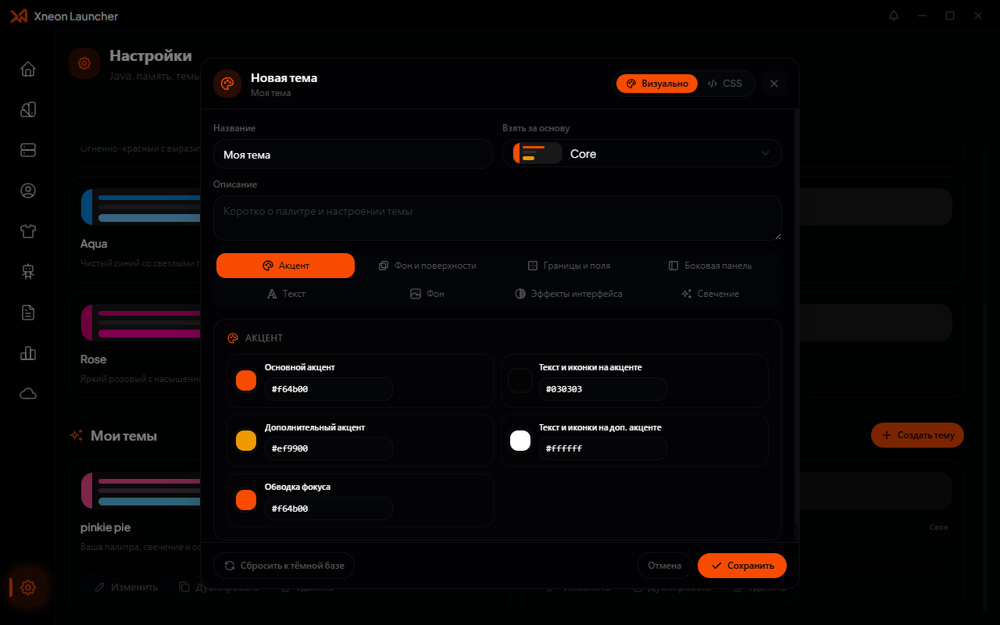
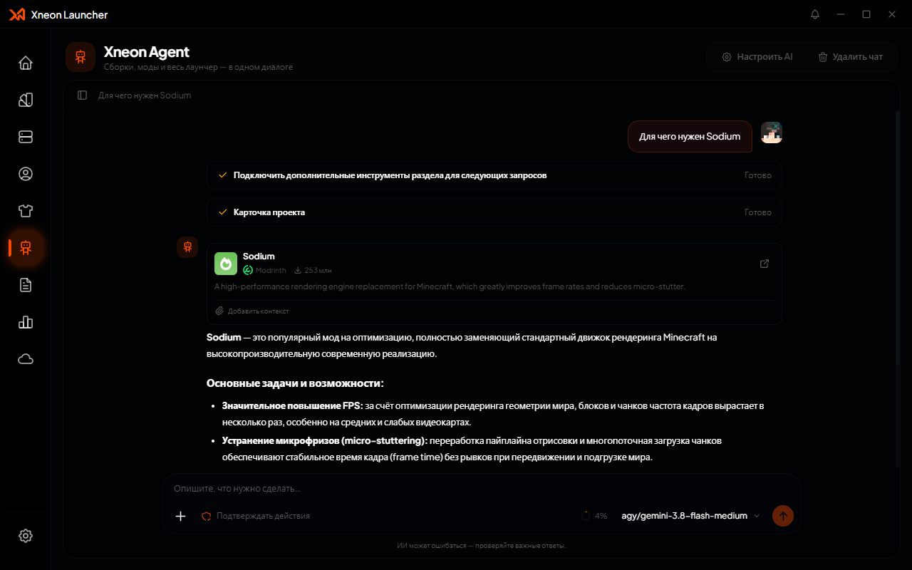
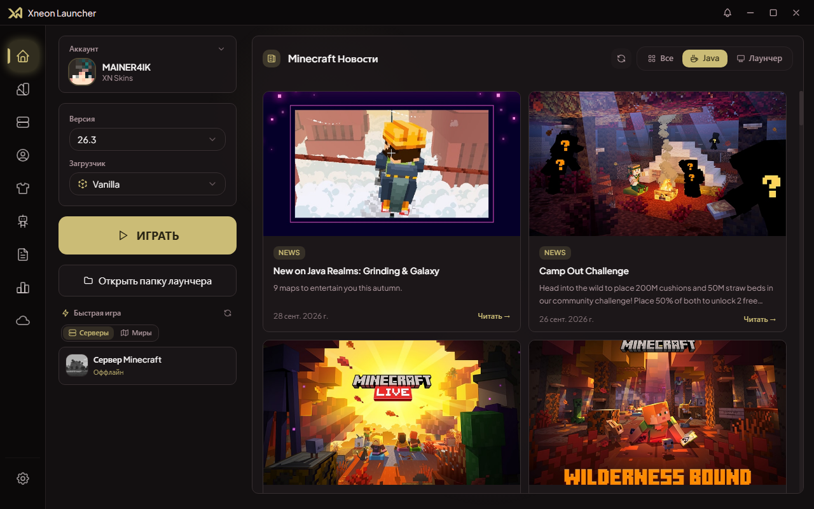
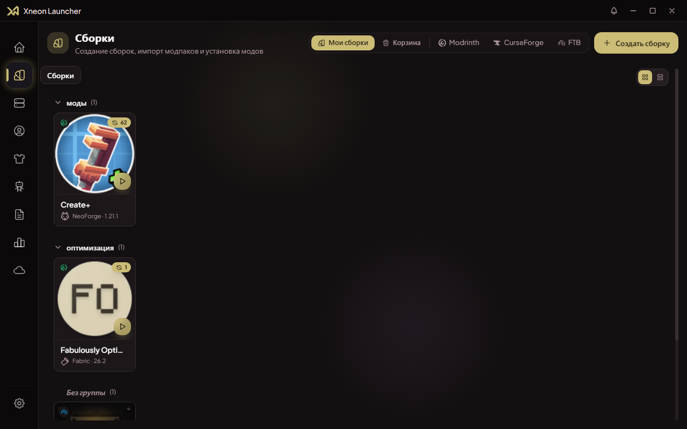
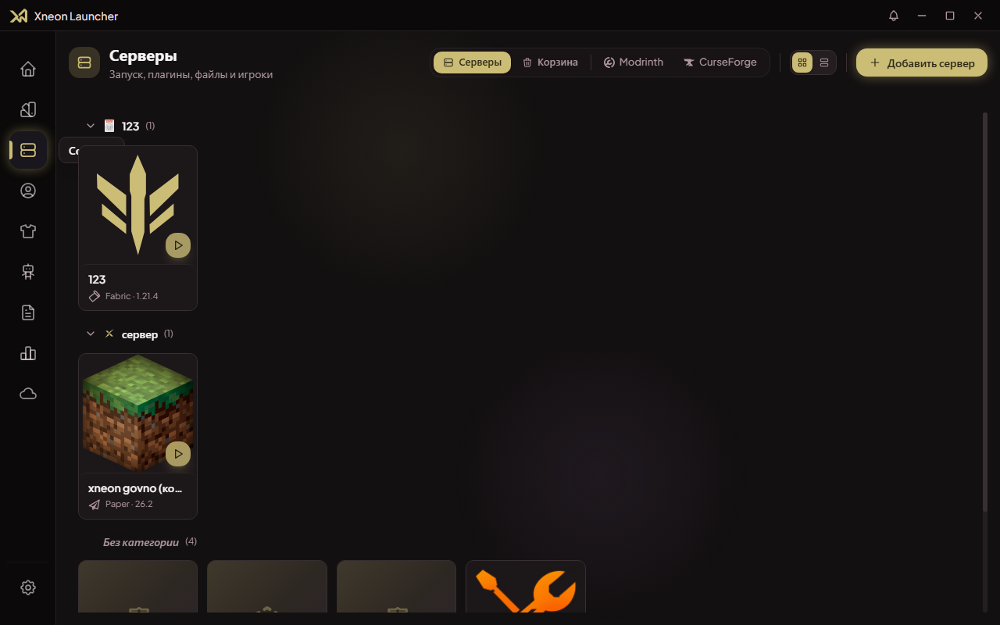
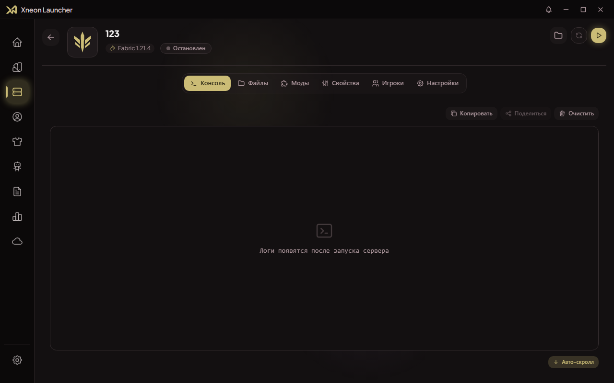
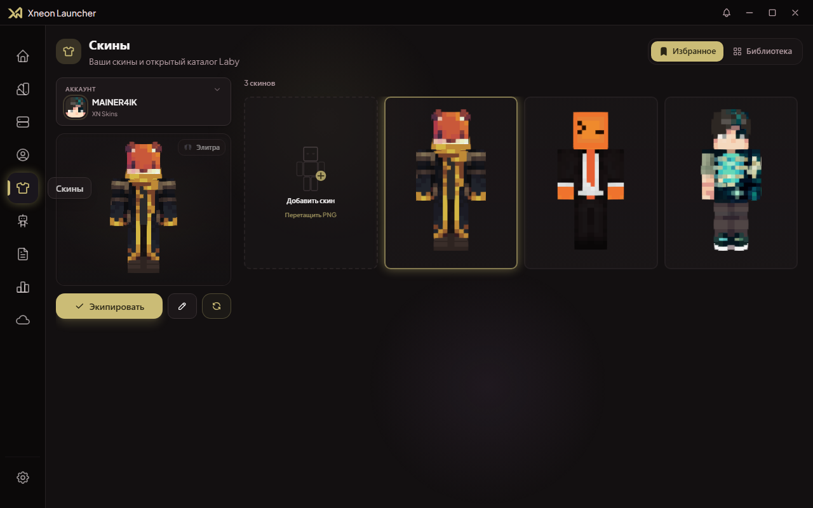
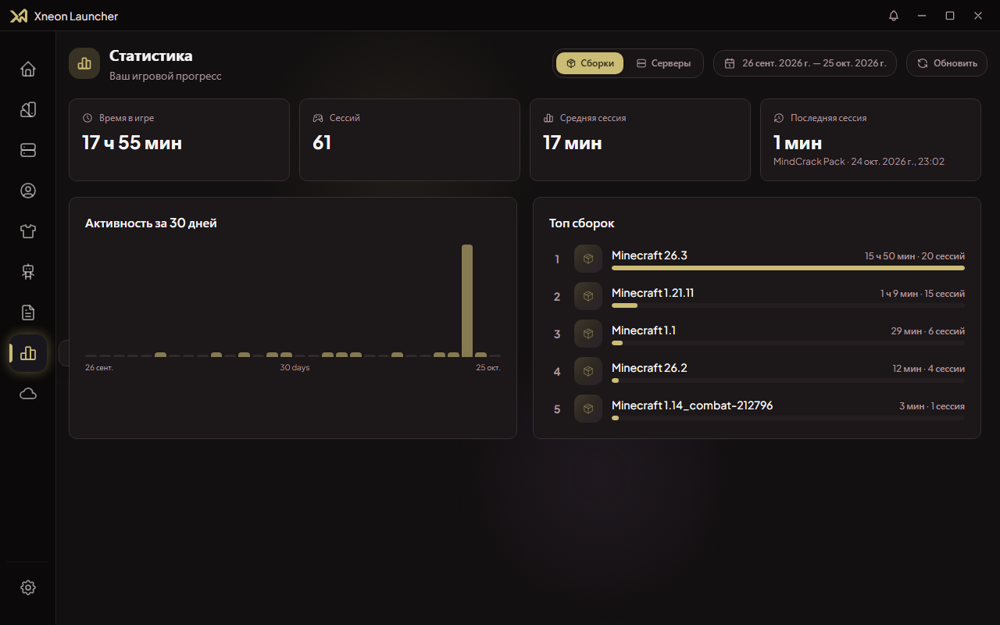
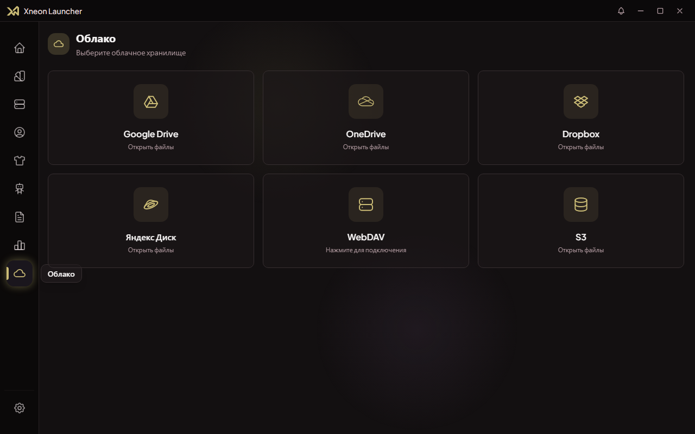
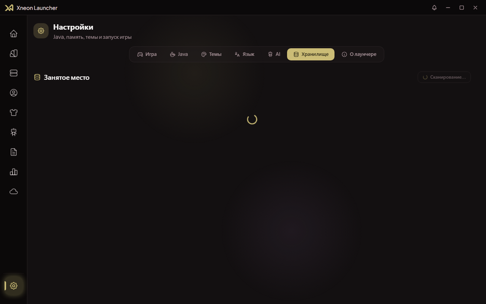

<p align="center">
  <a href="https://launcher.xneon.org" target="_blank">
    
  </a>
</p>

<h1 align="center">Xneon Launcher</h1>

<p align="center">
  <a href="https://github.com/XneonTeam/Xneon-Launcher/releases/latest">
    
  </a>
  <a href="https://github.com/XneonTeam/Xneon-Launcher/blob/main/LICENSE">
    
  </a>
  
  
  
  <br>
  
  
  
</p>

<p align="center">
  <strong>Xneon Launcher</strong> — современный лаунчер для Minecraft с открытым исходным кодом: сборки и моды, локальные серверы, облачная синхронизация, скины, статистика и AI-помощник в одном приложении.
</p>

<p align="center">
  🔗 <a href="https://docs.xneon.org"><strong>docs.xneon.org</strong></a> — документация лаунчера, тем, скинов и AI-помощника.
</p>

## Возможности

### Игра
- 🚀 **Запуск Minecraft** — Vanilla, Fabric, Quilt, Forge, NeoForge, LiteLoader и OptiFine; есть подготовка старых версий Forge и Legacy FML
- ⚡ **Быстрая игра** — быстрый переход в миры и недавние серверы с MOTD, онлайном, версией и пингом. Панель доступна на всех версиях, а Quick Play-параметры передаются только клиентам Java Edition 1.20+ (снапшоты от `23w14a`)
- ⚙️ **Гибкий запуск** — Java, память, аргументы JVM, команды до и после запуска, wrapper, переменные окружения, поведение лаунчера после старта игры
- 📊 **Статистика** — время в игре, сессии, аптайм серверов, графики активности и топы сборок
- 📜 **Логи запуска** — уровни, поиск, копирование и разбор краша через AI

### Контент
- 📥 **Modrinth, CurseForge и FTB** — поиск, установка и обновление модов, ресурспаков, шейдеров и модпаков
- 🗂 **Сборки** — изолированные профили со своими модами, мирами и настройками, категории, корзина, экспорт и импорт сборки в ZIP
- 🔄 **Автообновление контента** — бейджи обновлений, ченджлоги и обновление всего сразу
- 🧩 **Зависимости** — установка обязательных модов, проверка совместимости с версией загрузчика, распознавание уже установленного по проекту

### Серверы
- 🎮 **Локальные серверы** — мастер создания (Vanilla, Forge, Fabric, Quilt, NeoForge, Paper, Spigot, Bukkit, Purpur, Folia, Sponge, BungeeCord, Velocity, Waterfall или свой JAR), автозагрузка Java и ядра, консоль, файловый менеджер, `server.properties`, игроки (whitelist, операторы, баны), группы, корзина и экспорт в ZIP
- 🌐 **XN Connect** — сервер получает внешний адрес `connect.xneon.org`: друзья заходят без белого IP и настройки проброса портов

### Аккаунты и оформление
- 🔐 **Аккаунты** — Microsoft, Ely.by, XNSkins и оффлайн-режим, встроенный authlib-injector; аватары обновляются после смены скина
- 🎨 **Скины** — библиотека и каталог Laby с поиском и фильтрами, избранное, плащи и 3D-превью; результаты сканирования сохраняются при переключении вкладок
- ☁️ **Облако** — Google Drive, Dropbox, Яндекс.Диск, OneDrive, WebDAV и S3; просмотр и выборочная синхронизация сборок, серверов и аккаунтов, импорт и экспорт тем
- 🤖 **AI-помощник** — отдельные чаты, вложения с контекстом лаунчера, инструменты для работы со сборками и серверами, план действий и подтверждение операций. Поддерживаются OpenAI-совместимые API, Anthropic Messages, Google Gemini и Ollama
- 💾 **Хранилище** — разбор занятого места по категориям, повторное использование результатов сканирования при возврате во вкладку и очистка мусора
- 🌍 **Языки** — русский, английский, украинский, немецкий, испанский
- 🖼 **Темы** — готовые и собственные палитры с настройкой всех цветов, фона, эффектов интерфейса и свечения; CSS-редактор, импорт и экспорт `.xntheme`, синхронизация через облако
- ✨ **Анимации тем** — настройка появления содержимого или собственная CSS-анимация; панели и загруженные карточки появляются отдельно

## Скриншоты

| Редактор собственной темы на основе Core | AI-агент |
|---|---|
|  |  |

| Главная | Сборки |
|---|---|
|  |  |

| Серверы | Консоль сервера |
|---|---|
|  |  |

| Скины | Статистика |
|---|---|
|  |  |

| Облако | Хранилище |
|---|---|
|  |  |

## Быстрый старт

Нужны **Node.js 22+** и **pnpm 11+** (проект — pnpm-воркспейс, локальные пакеты подключаются через `workspace:*`).

```bash
# Установка зависимостей
pnpm install

# Запуск в режиме разработки (Vite + Electron)
pnpm run dev

# Проверка типов
pnpm run typecheck

# Production-сборка и упаковка в дистрибутив
pnpm run build
pnpm run package
```

## Импорт из других лаунчеров

Кнопка **«Импорт .zip»** принимает не только модпаки (`.mrpack`, CurseForge и экспорт Xneon), но и готовые клиентские версии вроде Lunar Crack: архивы с `<версия>/<версия>.json`, `<версия>.jar` и `natives`. Такая версия распаковывается в `versions/<id>` новой сборки, её natives доступны при запуске, а сборка автоматически использует её через `customVersionPath`.

Xneon автоматически обнаружит установленные сборки из:

| Лаунчер | Windows | macOS | Linux |
|---------|---------|-------|-------|
| Prism Launcher | `%APPDATA%\PrismLauncher\instances` | `~/Library/Application Support/PrismLauncher` | `~/.local/share/PrismLauncher` |
| MultiMC | `%APPDATA%\MultiMC\instances` | `~/Library/Application Support/multimc` | `~/.local/share/MultiMC` |
| PolyMC | `%APPDATA%\PolyMC\instances` | `~/Library/Application Support/PolyMC` | `~/.local/share/PolyMC` |
| GDLauncher Carbon | `%APPDATA%\gdlauncher_carbon\data\instances` | `~/Library/Application Support/gdlauncher_carbon/data/instances` | `~/.local/share/gdlauncher_carbon` |
| XMCL / X Launcher | `%APPDATA%\xmcl\instances` или `~\.minecraftx\instances` | `~/Library/Application Support/{xmcl,.minecraftx}/instances` | `~/.config/xmcl/instances` или `~/.minecraftx/instances` |
| Modrinth App | `%APPDATA%\ModrinthApp\app.db` | `~/Library/Application Support/ModrinthApp/app.db` | `~/.local/share/ModrinthApp/app.db` |
| Millida Launcher | `%APPDATA%\net.millida.launcher\minecraft\profiles` | `~/Library/Application Support/net.millida.launcher/minecraft/profiles` | `~/.local/share/net.millida.launcher/minecraft/profiles` |

### Что переносится вместе со сборкой

При импорте создаётся отдельная сборка Xneon с названием и иконкой исходной. В неё копируются:

- моды, ресурспаки и шейдеры;
- миры, настройки, скриншоты и остальные файлы игровой папки;
- выбранный профиль из общего каталога `versions` другого лаунчера: JSON, JAR и наследование через `inheritsFrom`;
- версия Minecraft, загрузчик и его версия.

Профили `versions` переносятся из Prism Launcher, MultiMC, PolyMC, GDLauncher Carbon, XMCL, Modrinth App и Millida Launcher. После импорта такой профиль используется `@xnlc/core` через `customVersionPath` и доступен сборке для запуска. При ручной смене Minecraft или загрузчика в Xneon привязка к импортированному профилю сбрасывается.

Если лаунчер установлен в нестандартном месте, в окне импорта можно вручную выбрать его корневую папку, каталог сборок или одну конкретную сборку. Для Modrinth App можно указать корень данных, `profiles` или `app.db`; для Millida — корень данных, игровой корень или `profiles`. Перенос игрового корня Millida через `game-root.txt` и внешние сборки XMCL через `instances.json` определяются автоматически.

## Разработка

Документация для разработчиков и авторов тем: [docs.xneon.org](https://docs.xneon.org).

### Архитектура

- **Renderer** (`components/`, `src/`, `lib/`) — интерфейс на React 19 + Vite 8 + Tailwind 4
- **Electron main** (`electron/main/`) — IPC-обработчики, база данных, запуск Minecraft в отдельном worker-процессе
- **Пакеты** (`packages/`) — доменная логика, подключённая как pnpm-воркспейс:
  - `@xnlc/core` — движок запуска Minecraft и загрузчики
  - `@xnlc/mods` — клиенты Modrinth, CurseForge и FTB
  - `@xnlc/servers` — ядра серверов, установка и управление процессами
  - `@xnlc/skins` — домен скинов: каталог Laby, библиотека, надевание
  - `@xnlc/agent` — AI-провайдеры, потоковые ответы, инструменты, контекст и чаты помощника
  - `@xnlc/nbt` — чтение и запись NBT (`level.dat`, `servers.dat`)
  - `@xnlc/types` — общие типы и IPC-контракты

### Команды

```bash
pnpm run dev           # Vite + Electron с hot-reload
pnpm run dev:fast      # то же, без пересборки main перед стартом
pnpm run build         # typecheck + сборка renderer и main
pnpm run package       # electron-builder → release/
pnpm run typecheck     # tsc --noEmit
pnpm run sync:xnlc     # собрать и перелинковать пакеты @xnlc/*
```

Переменные окружения: `XNLC_NEWS_URL` — адрес ленты новостей лаунчера (по умолчанию
`https://launcher.xneon.org/news.json`), `ELECTRON_DEBUG_PORT` — порт
remote-debugging для `scripts/launch-electron-dev.mjs` (по умолчанию не открывается).

### Структура

```
components/launcher/   # UI-компоненты (страницы, модалки, настройки)
electron/main/         # Electron main: IPC, БД, сборки, серверы, облако
electron/preload.ts    # Preload-скрипт (IPC-мост)
lib/                   # Общие утилиты renderer (кэш, форматирование, ссылки)
packages/              # Локальные пакеты @xnlc/*
src/                   # Точка входа renderer, i18n, контексты, хуки
public/                # Статические файлы и иконки лаунчеров
docs/screenshots/      # Скриншоты для README и релизов
```

### Данные лаунчера

| Платформа | Каталог |
|---|---|
| Windows | `%APPDATA%\xneonlauncher` |
| macOS | `~/Library/Application Support/xneonlauncher` |
| Linux | `~/.xneonlauncher` |

Внутри: `data.db` (SQLite, better-sqlite3), `cache/` (каталог Laby, каталог FTB), `intents/<сборка>/` — изолированный `.minecraft` каждой сборки, `mc-servers/<id>/` — локальные серверы, `skins/` — сохранённые скины.

## Лицензия

[GPL-3.0](LICENSE)

## Благодарности

- [Prism Launcher](https://prismlauncher.org/) — за вдохновение в области управления инстансами
- [X Minecraft Launcher](https://xmcl.app) — за отличный пример Electron-лаунчера
- [Modrinth](https://modrinth.com), [CurseForge](https://curseforge.com) и [FTB](https://api.modpacks.ch) — за API для модов и модпаков
- [skinview3d](https://github.com/bs-community/skinview3d) и [three.js](https://threejs.org) — за 3D-превью скинов
- [better-sqlite3](https://github.com/WiseLibs/better-sqlite3) — за быструю работу с базой данных
- [shadcn/ui](https://ui.shadcn.com) — за компоненты интерфейса
- [Tabler Icons](https://tabler-icons.io) — за иконки
